  <!-- 🌌 3D Cyber Waving Header -->
  

   

  <!-- 🧊 3D Rotating Data & Neural Network Animation -->
  

    

  <!-- ⚡ Live Terminal Command Typing Line -->
  

  

    📍 <b>India</b> &nbsp;|&nbsp; 🎓 <b>Computer Science Undergrad (Data Science)</b> &nbsp;|&nbsp; 🚀 <b>Lifelong Learner</b>
  

  <!-- 🌐 Social Network Pills -->
  

    
    &nbsp;
    
    &nbsp;
    
    &nbsp;
    
  

---

### 🧠 About Me & Analytical Dossier

> *"Without big data, you are blind and deaf and in the middle of a freeway."*

* 🔬 **Specialization:** Computer Science undergraduate with an intense focus on **Data Science, Predictive Modeling, and Feature Engineering**.
* 🎯 **The Objective:** Bridging the gap between raw, messy datasets and production-grade intelligent systems.
* 🛠️ **Current Research & Focus:** Deepening expertise in **Statistical Inference, Scikit-Learn pipelines, and Exploratory Data Analysis (EDA)**.
* 💻 **Full-Stack Background:** Hands-on experience engineering multi-tier web platforms, automated PDF billing engines, and client-side systems.
* 🎮 **Beyond The Code:** Experimenting with **Arduino microcontrollers**, gaming on **Riot Games & Epic Games**, and continuous tech learning.
* 🤝 **Open To:** Collaborative ML research, open-source data tooling, and student tech hackathons.

---

### ⚡ 3D Floating Tech Arsenal

  
<b>Core Data Science & Machine Learning</b>

  

    

  
<b>Data Warehousing & Storage</b>

  

    

  
<b>Languages, Systems & Hardware</b>

  

---

### 🔄 End-to-End Data Science Pipeline

```mermaid
flowchart LR
    A["📥 Ingestion\n(CSV / SQL / APIs)"] --> B["🧹 Wrangling\n(Pandas / NumPy)"]
    B --> C["📊 EDA\n(Seaborn / Stats)"]
    C --> D["⚙️ Feature Eng.\n(Scikit-Learn)"]
    D --> E["🧠 Modeling\n(Algorithms & Tuning)"]
    E --> F["🚀 Deployment\n& Storytelling"]
    
    style A fill:#0F172A,stroke:#00F0FF,stroke-width:1px,color:#fff
    style B fill:#0F172A,stroke:#38BDF8,stroke-width:1px,color:#fff
    style C fill:#0F172A,stroke:#818CF8,stroke-width:1px,color:#fff
    style D fill:#0F172A,stroke:#A855F7,stroke-width:1px,color:#fff
    style E fill:#0F172A,stroke:#EC4899,stroke-width:1px,color:#fff
    style F fill:#0F172A,stroke:#10B981,stroke-width:1px,color:#fff
```

---

### 🚀 Highlight Project

#### 🎓 [Apex Academy — Automated Academic & Attendance Analytics System](https://github.com/Armaan385/Fees-Attendance-system-)
> *An end-to-end institutional platform integrating real-time metrics, automated report generation, and student attendance analytics.*

* 📈 **Attendance Trend Analytics:** Automated algorithms calculating student attendance percentages, batch defaulter thresholds, and statistical warning flags.
* 💳 **Automated Accounting & Invoicing:** Real-time fee ledger computations, overdue projections, and computerized PDF receipts with verifiable QR codes.
* 🤖 **AI / Biometric Attendance Simulation:** Simulates batch roll-call hardware data to benchmark data ingestion and alert dispatches.
* 🛠️ **Tech Stack:** JavaScript (ES6+), Node.js, Modern CSS3, `jsPDF`, `html2canvas`.

  

---

### 📊 3D GitHub Pulse & Performance Matrix

  <!-- ==================== SECTION 1: STREAK & SUMMARY ==================== -->
  <h4>⚡ Real-Time Velocity & Contribution Streak</h4>
  
  &nbsp;
  

    

  <!-- ==================== SECTION 2: LANGUAGE DISTRIBUTION ==================== -->
  <h4>🧬 Codebase & Language Distribution</h4>
  

    

  <!-- ==================== SECTION 3: ACTIVITY TREND ==================== -->
  <h4>📈 30-Day Contribution Waveform</h4>
  

    

  <!-- ==================== SECTION 4: COMMIT SNAKE ==================== -->
  <h4>🐍 Interactive Contribution Calendar Matrix</h4>
  

    

  <!-- ==================== SECTION 5: TROPHIES & ACHIEVEMENTS ==================== -->
  <h4>🏆 Hall of Trophies & Milestones</h4>
  

    

  <!-- ==================== SECTION 6: DEV WISDOM ==================== -->
  

---

  <!-- 🌊 3D Cyber Wave Footer -->
  

  

    
  

  <b>Armaan Chaudhary</b> • Data Science Undergrad • Turning Data into Knowledge

